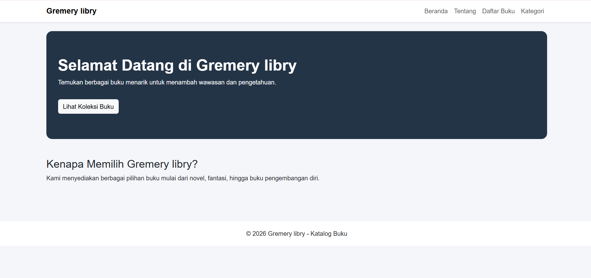
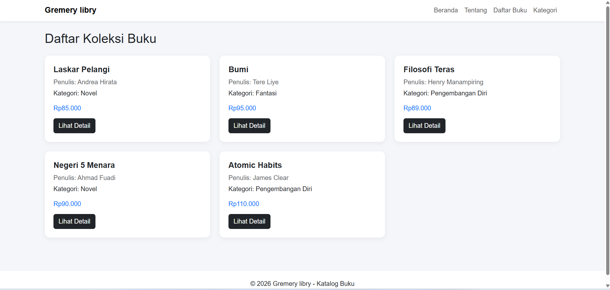
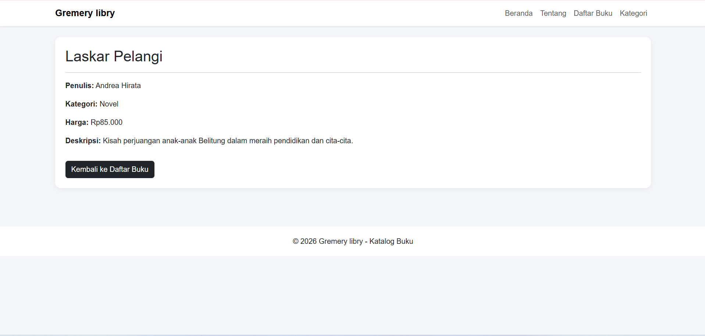
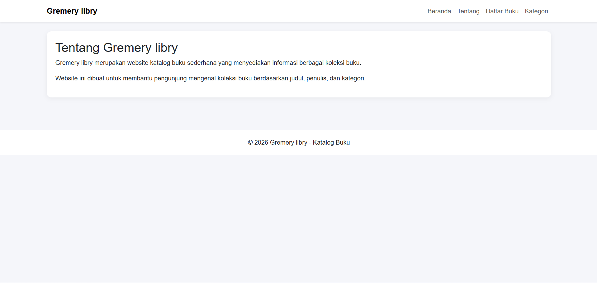
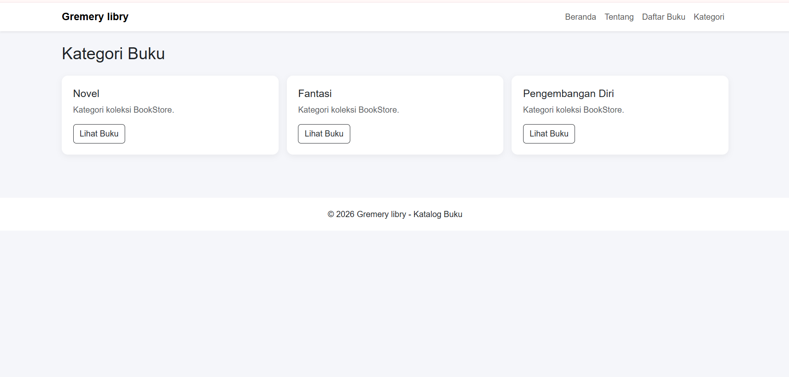

# Praktikum Laravel - Routing dan MVC

**Nama:** Akbar Syam Al Ghamar
**NIM:** C2483207013

**Tema:** Katalog Buku

## Deskripsi Aplikasi

Gremery libry merupakan website katalog buku
sederhana yang dibuat menggunakan framework Laravel.
Website ini menampilkan informasi buku berdasarkan
judul, penulis, kategori, harga, dan deskripsi.

## Implementasi Routing, Controller, dan View

### Routing
Routing digunakan untuk mengatur alamat URL
dan menghubungkannya dengan Controller.

### Controller
Controller digunakan untuk mengelola data buku
dalam bentuk array PHP dan mengirimkannya ke View.

### View
View dibuat menggunakan Blade Template untuk
menampilkan data kepada pengguna.

## Screenshot

### Halaman Beranda

### Halaman Daftar Buku

### Halaman Detail Buku

### Halaman Tentang

### Halaman Kategori

## Cara Menjalankan Proyek

1. Clone repository.
2. Masuk ke folder proyek.
3. Jalankan composer install.
4. Jalankan php artisan serve.
5. Buka http://127.0.0.1:8000
